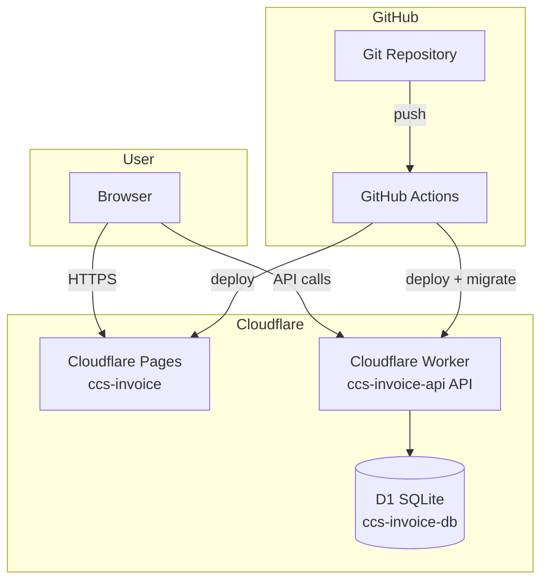
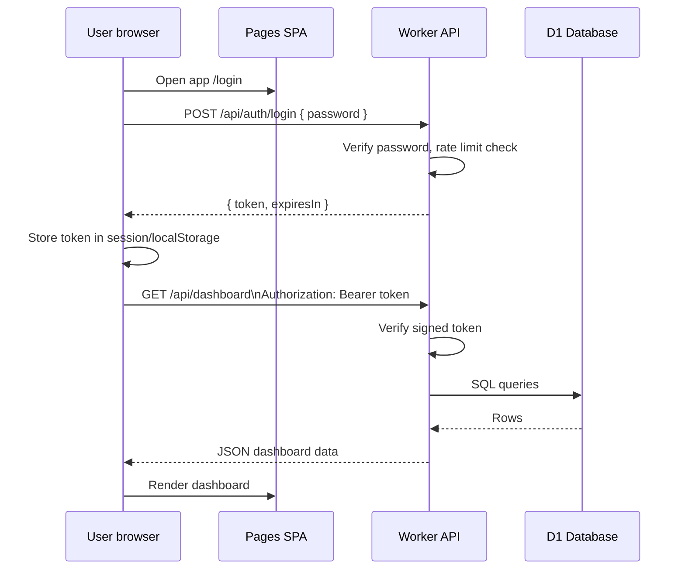
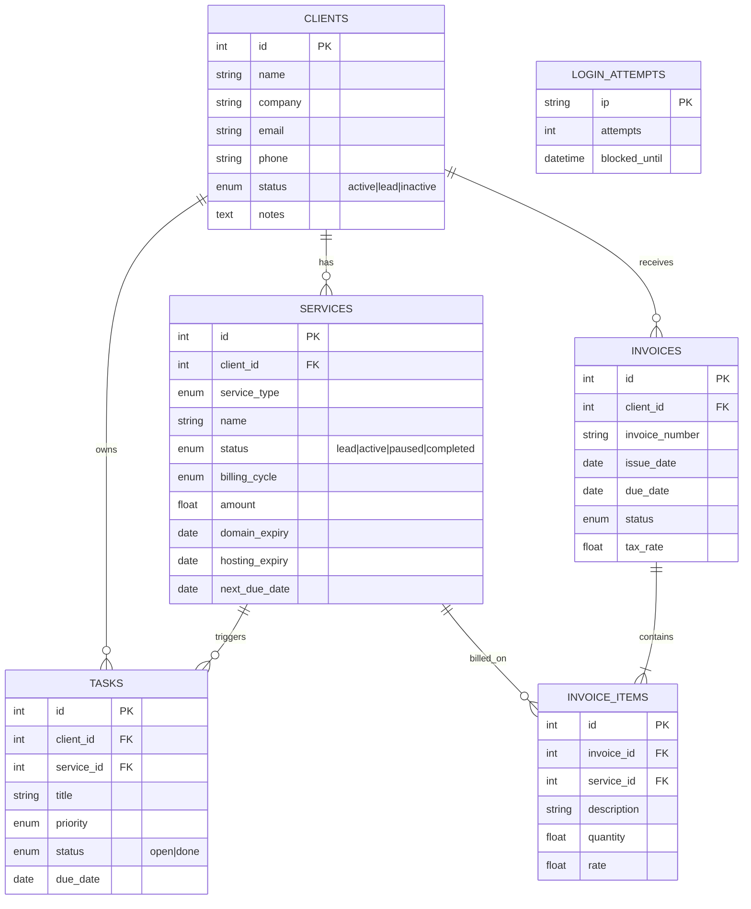
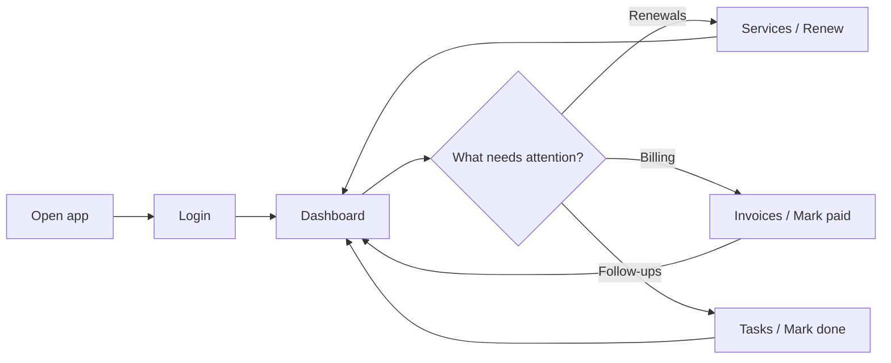
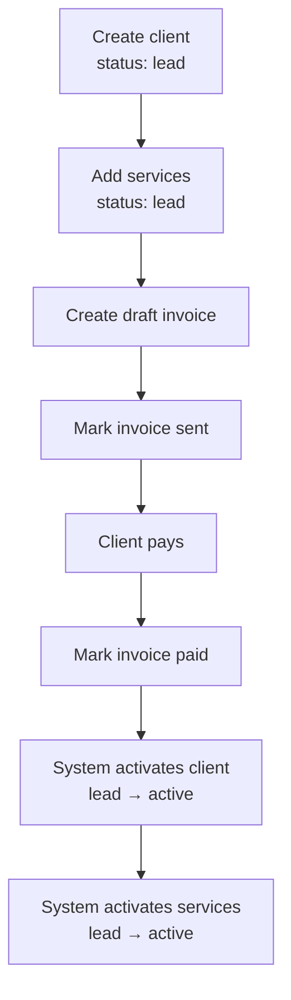
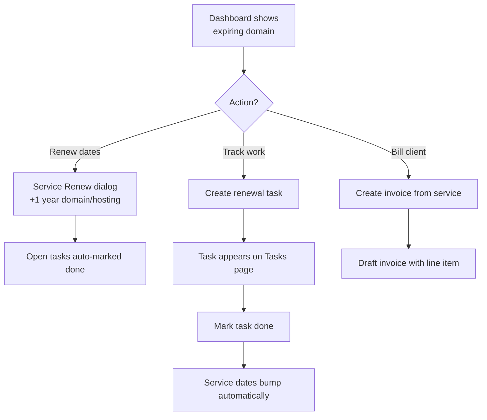
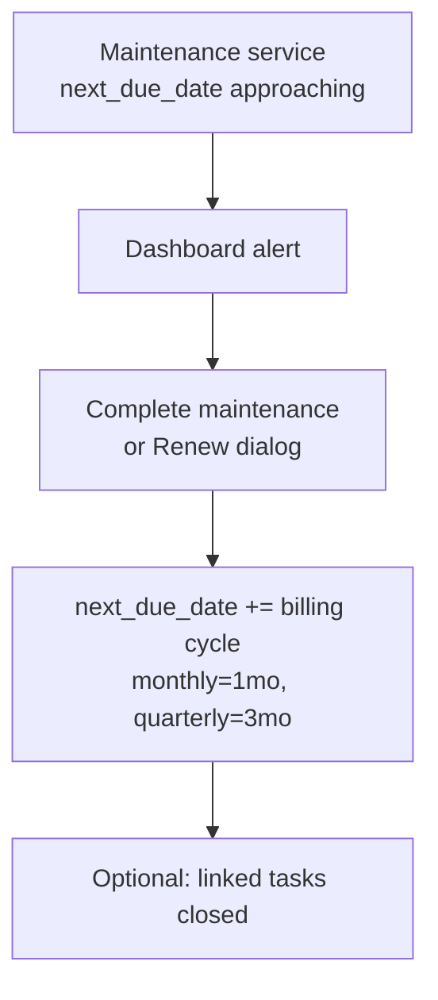
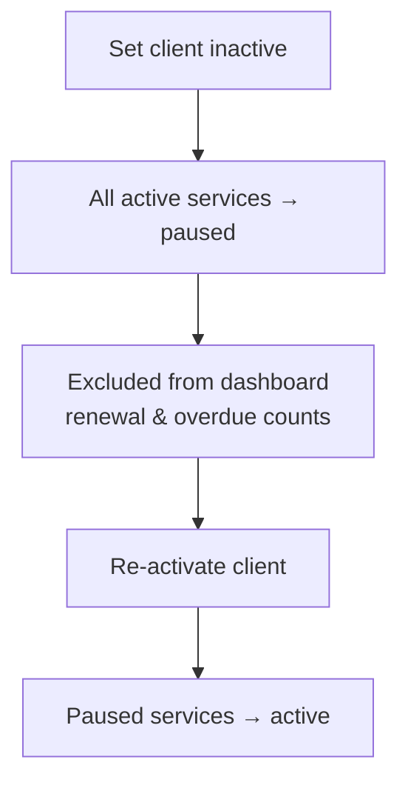
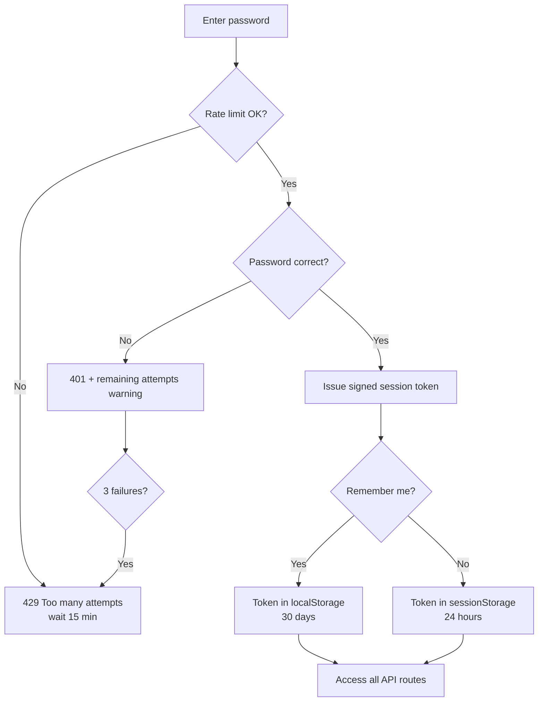
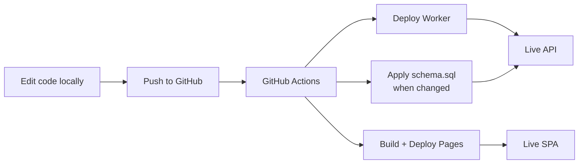

# Client CRM — Project Overview

> **Personal client relationship manager** for freelancers and small agencies who manage domains, hosting, maintenance, invoices, and follow-up tasks in one place.

---

## Table of contents

1. [Elevator pitch](#1-elevator-pitch)
2. [Problem & solution](#2-problem--solution)
3. [Who it is for](#3-who-it-is-for)
4. [Key capabilities](#4-key-capabilities)
5. [Technology stack](#5-technology-stack)
6. [System architecture](#6-system-architecture)
7. [Data model](#7-data-model)
8. [Application map & wireframes](#8-application-map--wireframes)
9. [User workflows](#9-user-workflows)
10. [Business logic & rules](#10-business-logic--rules)
11. [API overview](#11-api-overview)
12. [Security model](#12-security-model)
13. [Deployment & operations](#13-deployment--operations)
14. [Project structure](#14-project-structure)
15. [Future roadmap](#15-future-roadmap)

---

## 1. Elevator pitch

**Client CRM** is a lightweight, self-hosted workspace that replaces scattered spreadsheets, calendar reminders, and sticky notes with a single dashboard.

You can:

- Track **clients** (active, lead, archived)
- Manage **services** — domains, hosting, maintenance, design, content, email
- See **renewals before they expire**
- Create **invoices** and track payment status
- Assign **tasks** linked to clients and services
- Run **one-click workflows** — renew a domain, create a follow-up task, draft an invoice

It deploys entirely on **Cloudflare** (no server to maintain), builds from **GitHub Actions**, and is designed for **single-user / internal** use with password-protected API access.

---

## 2. Problem & solution

### The problem

Freelancers and solo operators often juggle:

| Pain point | Typical workaround |
|------------|-------------------|
| Domain/hosting expiry dates | Calendar alerts, registrar emails |
| Client contact info | Spreadsheet or phone contacts |
| Recurring maintenance | Mental notes, email threads |
| Invoices | Separate tool or Word/PDF |
| Follow-ups | Todo app disconnected from client context |

Data lives in **five different places**. Renewals get missed. Invoices drift. Client history is hard to see at a glance.

### The solution

One app with **linked modules**:

```
Client ──► Services ──► Tasks
   │           │
   └─────► Invoices
```

Everything shares the same database. A renewal on a service can auto-create a task. Paying an invoice can activate a lead client. The dashboard surfaces what needs attention today.

---

## 3. Who it is for

| Persona | Use case |
|---------|----------|
| **Freelance web developer** | Track client sites, hosting renewals, monthly maintenance |
| **Small agency owner** | Pipeline of leads → active clients, billing, deliverables |
| **IT / domain manager** | Registrar, hosting provider, expiry dates per client |

**Not designed for:** multi-tenant SaaS, large teams with role-based permissions, or payment processing (Stripe/PayPal). It tracks invoice *status*, not card charges.

---

## 4. Key capabilities

### Dashboard
- Active client count, service count, unpaid invoices, outstanding amount
- Monthly recurring revenue (normalized from billing cycles)
- Renewal pipeline (0–7, 8–14, 15–21, 22–30 day buckets)
- Lists: expiring services, overdue invoices, overdue tasks
- Quick actions: renew service, create task, create invoice

### Clients
- CRUD with name, company, email, phone, notes
- Status: **active**, **lead**, **inactive** (archived)
- Client detail page: KPIs, services, invoices, tasks, activity timeline

### Services (unified module)
Replaces legacy “Websites” with five service types:

| Type | Tracks |
|------|--------|
| `domain_hosting` | URL, registrar, domain expiry, hosting provider, hosting expiry, CMS |
| `website_maintenance` | Next due date, billing cycle |
| `logo_design` | Deliverables, amount |
| `content_writing` | Deliverables, amount |
| `email_configuration` | Email provider, accounts |

Each service has: status, billing cycle, amount, dates, notes.

### Invoices
- Line items linked to services (optional)
- Status workflow: draft → sent → paid / overdue / cancelled
- Auto-overdue sync when due date passes
- Edit drafts; cancel sent/overdue invoices

### Tasks
- Open / done, priority (low / medium / high)
- Linked to client and/or service
- Completing a renewal task can bump service dates

### Settings
- Profile, connection test, sign out
- Demo data load/remove (for exploration)
- Backup & restore: full JSON export, import (merge or replace), and CSV export per module
- Password managed via Cloudflare `API_SECRET`

---

## 5. Technology stack

| Layer | Technology |
|-------|------------|
| **Frontend** | React 18, TypeScript, Vite |
| **UI** | Tailwind CSS, shadcn/ui (Radix), Lucide icons |
| **State / data** | TanStack Query, React Router |
| **Backend** | Cloudflare Workers (Hono framework) |
| **Database** | Cloudflare D1 (SQLite) |
| **Hosting** | Cloudflare Pages (frontend) + Workers (API) |
| **CI/CD** | GitHub Actions |
| **Auth** | Shared `API_SECRET` + signed session tokens |

---

## 6. System architecture

### High-level diagram



### Request flow (authenticated)



### Frontend routing

| Route | Page | Auth |
|-------|------|------|
| `/login` | Login | Public |
| `/` | Dashboard | Protected |
| `/clients` | Client list | Protected |
| `/clients/:id` | Client detail | Protected |
| `/services` | Services list | Protected |
| `/invoices` | Invoices | Protected |
| `/tasks` | Tasks | Protected |
| `/settings` | Settings | Protected |
| `/websites` | Redirect → `/services` | Protected |

---

## 7. Data model

### Entity relationship



### Status enums

**Client status**

| Value | Meaning | Side effects |
|-------|---------|--------------|
| `active` | Current client | Services can be active |
| `lead` | Prospect | New services default to `lead` |
| `inactive` | Archived | Active services → `paused` |

**Service status**

| Value | Meaning |
|-------|---------|
| `lead` | Not yet live / prospect work |
| `active` | In progress or live |
| `paused` | Client archived |
| `completed` | Deliverable finished |

**Invoice status**

| Value | Meaning |
|-------|---------|
| `draft` | Editable, not sent |
| `sent` | Awaiting payment |
| `overdue` | Past due (auto-synced from `sent`) |
| `paid` | Settled |
| `cancelled` | Voided |

---

## 8. Application map & wireframes

### App shell (desktop)

```
┌──────────────────────────────────────────────────────────────────────────┐
│ ┌─────────────┐  ┌──────────────────────────────────────────────────────┐  │
│ │ Client CRM  │  │  [Page content area]                               │  │
│ │ Personal    │  │                                                      │  │
│ ├─────────────┤  │  PageHeader: title + description + actions           │  │
│ │ Dashboard   │  │  ─────────────────────────────────────────────────   │  │
│ │ Clients     │  │  Cards / tables / forms                              │  │
│ │ Services    │  │                                                      │  │
│ │ Invoices    │  │                                                      │  │
│ │ Tasks    (3)│  │                                                      │  │
│ │ Settings    │  │                                                      │  │
│ ├─────────────┤  │                                                      │  │
│ │ [Sign out]  │  │                                                      │  │
│ └─────────────┘  └──────────────────────────────────────────────────────┘  │
└──────────────────────────────────────────────────────────────────────────┘
     Sidebar 256px                    Main content (scrollable)
```

### Mobile shell

```
┌─────────────────────────┐
│ Client CRM        [Logout]│  ← top bar
├─────────────────────────┤
│                         │
│   Page content          │
│                         │
├─────────────────────────┤
│ Dash │Clients│Svc│Inv│⚙│  ← bottom nav (Tasks badge on overdue)
└─────────────────────────┘
```

---

### Wireframe: Login

```
┌─────────────────────────────────────────────────────────────┐
│  [Brand panel — desktop only]  │  ┌─────────────────────┐  │
│  Client CRM                    │  │ Welcome back        │  │
│  Manage clients, domains       │  │                     │  │
│  & invoices                    │  │ Password [••••••] 👁 │  │
│                                │  │ ☐ Remember me       │  │
│  • Track clients               │  │                     │  │
│  • Monitor renewals            │  │ [ Sign in ]         │  │
│  • Manage invoices             │  └─────────────────────┘  │
└─────────────────────────────────────────────────────────────┘
```

---

### Wireframe: Dashboard

```
┌─────────────────────────────────────────────────────────────┐
│ Dashboard                                    [Refresh]       │
│ Your command center for renewals, billing, and tasks         │
├─────────────────────────────────────────────────────────────┤
│ ┌─────────┐ ┌─────────┐ ┌─────────┐ ┌─────────┐            │
│ │Active   │ │Services │ │Unpaid   │ │Monthly  │            │
│ │Clients  │ │         │ │Invoices │ │Revenue  │            │
│ │   12    │ │   28    │ │    4    │ │ $1,240  │            │
│ └─────────┘ └─────────┘ └─────────┘ └─────────┘            │
├─────────────────────────────────────────────────────────────┤
│ Attention needed          │ Renewal pipeline (30d)          │
│ • 5 renewals              │ [====----] 0-7 days: 2          │
│ • 3 overdue invoices      │ [==------] 8-14 days: 1       │
│ • 2 overdue tasks         │ ...                             │
├───────────────────────────┴─────────────────────────────────┤
│ Expiring soon                    │ Overdue invoices         │
│ ┌──────────────────────────────┐ │ ┌──────────────────────┐│
│ │ Acme Site · Domain · 5d left │ │ │ INV-004 · $250       ││
│ │ [Renew] [Task] [Invoice]     │ │ │ Bella Vista · 12d    ││
│ └──────────────────────────────┘ │ └──────────────────────┘│
└─────────────────────────────────────────────────────────────┘
```

---

### Wireframe: Clients list

```
┌─────────────────────────────────────────────────────────────┐
│ Clients                                      [+ Add client]    │
│ [Search........................]  [All|Active|Lead|Inactive]   │
├─────────────────────────────────────────────────────────────┤
│ Name          Company        Status    Email                  │
│ Sarah M.      Acme Corp      Active    sarah@...              │
│ Priya S.      TechStart      Lead      priya@...         →   │
│ Michael C.    Old Client Co  Inactive  michael@...       →   │
└─────────────────────────────────────────────────────────────┘
```

---

### Wireframe: Client detail

```
┌─────────────────────────────────────────────────────────────┐
│ ← Clients    Sarah Mitchell · Acme Corp        [Edit] [···]  │
├─────────────────────────────────────────────────────────────┤
│ [Active]  sarah@email.com  +1 555-0101                       │
├─────────────────────────────────────────────────────────────┤
│ KPIs: 2 services · 1 renewal due · 1 open task · $25/mo     │
├─────────────────────────────────────────────────────────────┤
│ [Overview] [Services] [Invoices] [Tasks] [Activity]        │
├─────────────────────────────────────────────────────────────┤
│ Services tab:                                                │
│ ┌ Acme Main Site ─ domain_hosting ─ active ─ $25/mo ──────┐ │
│ │ Domain: 2026-06-28 (5d)  Hosting: 2026-09-15           │ │
│ │ [Renew] [Create task] [Create invoice]                   │ │
│ └──────────────────────────────────────────────────────────┘ │
└─────────────────────────────────────────────────────────────┘
```

---

### Wireframe: Services

```
┌─────────────────────────────────────────────────────────────┐
│ Services                                     [+ Add service] │
│ [Search...] [Type ▼] [Renewal ▼] [Status ▼]                │
├─────────────────────────────────────────────────────────────┤
│ Card grid or table:                                          │
│ ┌──────────────────┐  ┌──────────────────┐                   │
│ │ 🌐 Acme Main Site│  │ 🔧 Monthly Maint │                   │
│ │ Acme Corp        │  │ GreenLeaf        │                   │
│ │ Domain 5d · $25  │  │ Due in 3d · $45  │                   │
│ │ [Renew][Task][Inv]│  │ [Complete][Task] │                   │
│ └──────────────────┘  └──────────────────┘                   │
└─────────────────────────────────────────────────────────────┘
```

---

### Wireframe: Invoices

```
┌─────────────────────────────────────────────────────────────┐
│ Invoices                                   [+ New invoice]   │
│ [Search...]  [All|Draft|Sent|Overdue|Paid]                   │
├─────────────────────────────────────────────────────────────┤
│ #       Client      Due        Total     Status    Actions   │
│ INV-001 Acme Corp   Jun 28     $250      Sent      [Paid][···]│
│ INV-002 GreenLeaf   Jul 05     $45       Overdue   [Paid][···]│
│ INV-003 TechStart   —          $120      Draft     [Edit][···]│
└─────────────────────────────────────────────────────────────┘
```

---

### Wireframe: Tasks

```
┌─────────────────────────────────────────────────────────────┐
│ Tasks                                        [+ New task]    │
│ [Search...]  [Open|Done|Overdue]  [Priority ▼]               │
├─────────────────────────────────────────────────────────────┤
│ ☐ Renew domain — Acme Main Site     High · Jun 24 · Acme    │
│ ☐ Send proposal — TechStart         Med  · Jun 30 · TechStart│
│ ☑ Maintenance due — GreenLeaf       Done · Jun 20           │
└─────────────────────────────────────────────────────────────┘
```

---

### Wireframe: Settings

```
┌─────────────────────────────────────────────────────────────┐
│ Settings                                                     │
├──────────┬──────────────────────────────────────────────────┤
│Connection│ Profile hero + edit                              │
│Security  │ API connection: ● Connected                      │
│Data      │ Demo data: [Load] [Remove]                       │
│System    │ Sign out                                         │
└──────────┴──────────────────────────────────────────────────┘
```

---

## 9. User workflows

### A. Daily operator flow



### B. New lead → paying client



### C. Domain renewal workflow



### D. Maintenance cycle



### E. Archive client



### F. Authentication flow



---

## 10. Business logic & rules

### Renewal attention

A service **needs attention** when:

| Service type | Condition |
|--------------|-----------|
| `domain_hosting` | Domain expiry **or** hosting expiry is expired or within **30 days** |
| `website_maintenance` | `next_due_date` is expired or within **30 days** |
| Other types | No automatic renewal tracking |

**Dashboard counts** only include **active clients** with **active services** (leads and archived clients excluded from renewal/overdue task alerts).

### Renewal date bump rules

| Action | Effect |
|--------|--------|
| **Renew service** (domain/hosting) | Add 1–3 years to domain and/or hosting expiry from current date or existing expiry (whichever is later) |
| **Complete maintenance** | `next_due_date` += interval from billing cycle |
| **Mark renewal task done** | Parses task title → bumps matching dates (domain / hosting / maintenance) |

### Invoice logic

| Rule | Detail |
|------|--------|
| **Auto-overdue** | On dashboard/list load, `sent` invoices past `due_date` → `overdue` |
| **Effective status** | UI treats `sent` + past due as `overdue` even before sync |
| **Edit** | Only `draft` invoices editable |
| **Status transitions** | draft→sent/cancelled, sent→paid/cancelled, overdue→paid/cancelled |
| **Pay invoice** | Activates lead client + lead services |
| **Invoice numbering** | Auto `INV-001`, `INV-002`, … |
| **Draft dedupe** | `create-invoice` from service returns existing draft if one exists for that service |

### Monthly recurring revenue (dashboard)

Normalized from active services on active clients:

| Billing cycle | Monthly contribution |
|---------------|-------------------|
| `monthly` | Full amount |
| `quarterly` | amount ÷ 3 |
| `annual` | amount ÷ 12 |
| `one_time` / `none` | Excluded |

### Task logic

| Rule | Detail |
|------|--------|
| **Create from service** | Dedupes: returns existing open task for same service |
| **Default due date** | From domain/hosting/maintenance expiry or `next_due_date` |
| **Complete task** | If linked to service, bumps service dates per task title |
| **Nav badge** | Count of open tasks with past due date |

### Client ↔ service sync

| Client change | Service effect |
|---------------|----------------|
| → `inactive` | Active services → `paused` |
| → `active` | Paused services → `active` |
| New service on lead client | Service defaults to `lead` |
| New service on active client | Service defaults to `active` |

---

## 11. API overview

Base path: `/api` on the Cloudflare Worker.

### Public endpoints

| Method | Path | Purpose |
|--------|------|---------|
| GET | `/health` | Health check |
| POST | `/auth/login` | Password login → session token |

### Protected endpoints (Bearer token required)

| Module | Methods | Paths |
|--------|---------|-------|
| Auth | GET | `/auth/check` |
| Dashboard | GET | `/dashboard` |
| Clients | GET, POST, PUT, DELETE | `/clients`, `/clients/:id` |
| Services | GET, POST, PUT, DELETE | `/services`, `/services/:id` |
| Services actions | POST | `/services/:id/renew`, `/complete-maintenance`, `/create-task`, `/create-invoice` |
| Invoices | GET, POST, PUT, DELETE, PATCH | `/invoices`, `/invoices/:id`, `/invoices/:id/status` |
| Tasks | GET, POST, PUT, DELETE, PATCH | `/tasks`, `/tasks/:id`, `/tasks/:id/status` |
| Demo | GET, POST, DELETE | `/demo/status`, `/demo/load`, `/demo` |
| Data | GET, POST | `/data/export` (full JSON backup), `/data/import` (merge or replace) |
| Legacy | * | `/websites/*` (shim over domain_hosting services) |

---

## 12. Security model

### Authentication

1. User submits password to `/api/auth/login`
2. Server verifies against Cloudflare secret `API_SECRET`
3. Server returns **HMAC-signed session token** (not the password)
4. Frontend sends `Authorization: Bearer <token>` on all requests
5. Token expires: **24 hours** (default) or **30 days** (remember me)

### Protections implemented

| Control | Description |
|---------|-------------|
| Fail-closed auth | Missing `API_SECRET` → all routes return 503 |
| CORS allowlist | Only configured Pages origin + localhost |
| Login rate limit | 3 failed attempts → 15-minute IP lockout |
| Timing-safe password compare | Prevents basic timing attacks |
| Parameterized SQL | All queries use bound parameters |
| API URL not in docs | Worker URL stored in GitHub Secrets only |

### Recommended before public production

- Cloudflare Access in front of Worker/Pages
- Security headers (CSP) on Pages
- Disable demo routes in production
- Strong random `API_SECRET` (32+ characters)

---

## 13. Deployment & operations



### GitHub secrets required

| Secret | Purpose |
|--------|---------|
| `CLOUDFLARE_API_TOKEN` | Deploy permissions |
| `CLOUDFLARE_ACCOUNT_ID` | Account targeting |
| `WORKER_API_URL` | Baked into frontend build |
| `PAGES_PROJECT_NAME` | Optional, default `ccs-invoice` |

### Cloudflare secrets

| Secret | Purpose |
|--------|---------|
| `API_SECRET` | Login password for the CRM |

### Operational tasks

| Task | How |
|------|-----|
| Deploy code | Push to `main` / `master` |
| Apply DB schema | Auto on `schema.sql` change, or manual workflow |
| Load demo data | Settings → Data, or CI workflow |
| Change password | Cloudflare → ccs-invoice-api → `API_SECRET` |
| Rotate session | Change `API_SECRET` (invalidates all tokens) |

See **[DEPLOY.md](./DEPLOY.md)** for step-by-step setup.

---

## 14. Project structure

```
App/
├── .github/workflows/
│   ├── deploy.yml          # Build & deploy on push
│   └── seed.yml            # Optional demo data load
├── web/                    # React frontend
│   ├── src/
│   │   ├── pages/          # Route pages
│   │   ├── components/     # UI + layout + workflow
│   │   ├── lib/            # API client, renewals, invoices, utils
│   │   └── context/        # Auth, toast
│   └── vite.config.ts
├── worker/                 # Cloudflare Worker API
│   ├── src/
│   │   ├── routes/         # Hono route handlers
│   │   ├── lib/            # session, rate-limit, invoices, service-actions
│   │   └── index.ts        # App entry + middleware
│   ├── schema.sql          # D1 schema
│   ├── seed.sql            # Demo data
│   └── wrangler.toml       # Worker + D1 config
├── DEPLOY.md               # Deployment guide
├── README.md               # Quick start
└── PROJECT-OVERVIEW.md     # This document
```

---

## 15. Future roadmap

| Priority | Enhancement |
|----------|-------------|
| High | Cloudflare Access (email gate before CRM login) |
| High | Proxy API through `/api` on Pages (hide Worker URL from browser) |
| Medium | Security headers (CSP, X-Frame-Options) |
| Medium | Session revocation / server-side logout |
| Medium | Disable demo routes in production |
| Low | Custom domain for Pages + Worker route |
| ✅ Done | Export/import all data (JSON backup & restore) + CSV export per module |
| Low | Email reminders for renewals (Workers + email API) |
| Future | Multi-user accounts with roles |
| Future | Payment gateway integration |

---

## Summary

**Client CRM** connects clients, services, invoices, and tasks into one coherent system with smart renewal tracking and workflow automation. It runs serverlessly on Cloudflare, deploys from GitHub, and is optimized for a solo operator who needs clarity on **what expires, what’s unpaid, and what to do next** — without enterprise CRM complexity.

---

*Document version: 1.0 · Generated for internal project reference*
