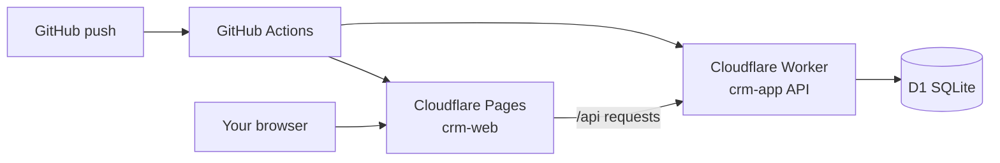

# Client CRM

Personal client, website, and invoice management app.

- **Frontend:** React + Vite + shadcn/ui (Tailwind)
- **Backend:** Cloudflare Workers + D1 (SQLite)
- **Deploy:** GitHub Actions → Cloudflare (no Node.js needed on your PC)

## Go live

**Follow [DEPLOY.md](./DEPLOY.md)** — step-by-step guide to push to GitHub and deploy on Cloudflare.

Summary:

1. Create D1 database in Cloudflare Dashboard → paste ID into `worker/wrangler.toml`
2. Push this folder to GitHub
3. Add GitHub secrets: `CLOUDFLARE_API_TOKEN`, `CLOUDFLARE_ACCOUNT_ID`, and `WORKER_API_URL` (see [DEPLOY.md](./DEPLOY.md))
4. Run the **Deploy to Cloudflare** GitHub Action
5. Add `API_SECRET` in Cloudflare → **crm-app** → Variables and Secrets

Open the live app from **Cloudflare Dashboard → Workers & Pages → crm-web → Visit site**.

> Deploy steps, secrets, and troubleshooting are in [DEPLOY.md](./DEPLOY.md). Do not commit your Worker API URL to the repo.

## Project structure

```
App/
├── .github/workflows/deploy.yml   # Auto-build & deploy on push
├── worker/                        # Cloudflare Worker API + D1
└── web/                           # React frontend
```

## Features

| Module | What it does |
|--------|--------------|
| **Dashboard** | Active clients, expiring domains/hosting, overdue invoices |
| **Clients** | CRUD contacts with status (active/inactive/lead) |
| **Websites** | Domain, hosting, SSL expiry per client |
| **Invoices** | Create invoices, mark sent/paid |
| **Settings** | Account info and sign out |

## Architecture


