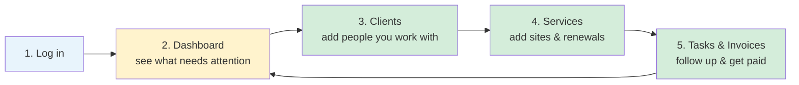
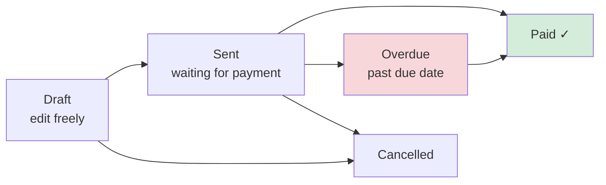
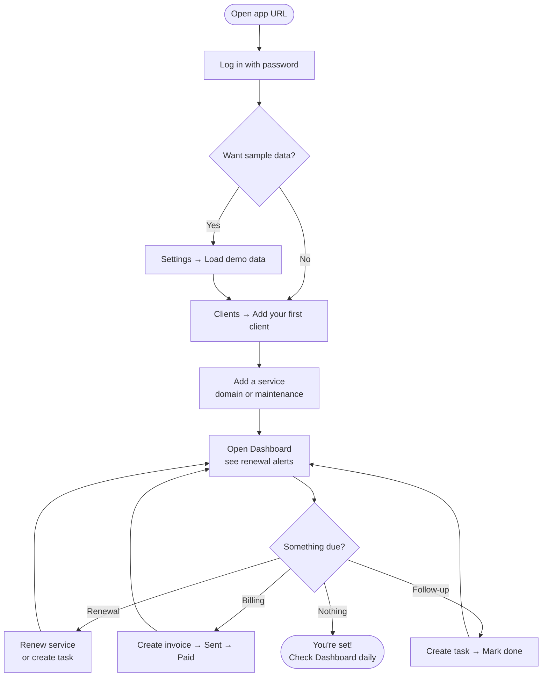

# Client CRM — New User Guide

Welcome! This guide shows **how the app works** from a new user’s perspective — what you see on each screen and what to do step by step.

---

## What is Client CRM?

Client CRM is your **personal workspace** to manage:

- **Clients** — contacts, companies, leads, and archived accounts  
- **Services** — websites, domains, hosting, maintenance, and other work you deliver  
- **Invoices** — what you bill and whether it’s paid  
- **Tasks** — follow-ups, renewals, and to-dos linked to clients  

Everything connects: a client has services → services can create tasks and invoices → the **Dashboard** tells you what needs attention today.

---

## How you move through the app (overview)



**Typical day:** Log in → check Dashboard → fix renewals / invoices / tasks → done.

---

## The app layout (where things live)

### On computer (sidebar)

```
┌────────────────┬─────────────────────────────────────────────┐
│  Client CRM    │                                             │
│  Personal      │   ← Main area: page you selected             │
│  workspace     │                                             │
├────────────────┤                                             │
│ ● Dashboard    │   Examples:                                  │
│   Clients      │   • Stats cards at top                       │
│   Services     │   • Lists of renewals, invoices, tasks       │
│   Invoices     │   • Buttons: Renew, Add, Mark paid           │
│   Tasks     ⚠  │                                             │
│   Settings     │   ⚠ = red badge = overdue tasks count        │
├────────────────┤                                             │
│  Sign out      │                                             │
└────────────────┴─────────────────────────────────────────────┘
```

### On phone (bottom bar)

```
┌─────────────────────────────────────┐
│         Page content                │
│                                     │
├─────────────────────────────────────┤
│ Home │Clients│Services│Tasks│Bills│⚙│
└─────────────────────────────────────┘
   Dashboard = "Home"
   Invoices = "Bills"
```

---

## Step 1 — Log in

**What you need:** Your CRM password (set once in Cloudflare as `API_SECRET`).

```
┌─────────────────────────────────────┐
│         Welcome back                │
│  Sign in with your password         │
│                                     │
│  Password  [••••••••••]  👁         │
│                                     │
│  ☐ Remember me on this device       │
│     (keeps you signed in longer)    │
│                                     │
│  [        Sign in        ]          │
└─────────────────────────────────────┘
```

| What happens | What you should know |
|--------------|-------------------|
| Correct password | You land on the **Dashboard** |
| Wrong password | You see how many tries remain before a short lockout |
| 3 wrong tries | Wait ~15 minutes, then try again |
| Session expired | Log in again — your data is safe |

---

## Step 2 — Dashboard (your home screen)

**Purpose:** One place to see **what needs action today**.

```
┌─────────────────────────────────────────────────────────────┐
│  Dashboard                                                   │
│  Your command center for renewals, billing, and tasks        │
├─────────────────────────────────────────────────────────────┤
│  ┌──────────┐ ┌──────────┐ ┌──────────┐ ┌──────────┐      │
│  │ Active   │ │ Services │ │ Unpaid   │ │ Monthly  │      │
│  │ clients  │ │          │ │ invoices │ │ revenue  │      │
│  │    12    │ │    28    │ │     4    │ │  $1,240  │      │
│  └──────────┘ └──────────┘ └──────────┘ └──────────┘      │
│       ↑ click a card to jump to that section                 │
├─────────────────────────────────────────────────────────────┤
│  ⚠ Attention needed                                          │
│     • Renewals due                                           │
│     • Overdue invoices                                       │
│     • Overdue tasks                                          │
├─────────────────────────────────────────────────────────────┤
│  Expiring soon                    Overdue invoices           │
│  ┌─────────────────────────┐    ┌─────────────────────┐   │
│  │ Acme Site · 5 days left │    │ INV-004 · $250 due  │   │
│  │ [Renew] [Task] [Invoice]│    │ [Mark paid]         │   │
│  └─────────────────────────┘    └─────────────────────┘   │
└─────────────────────────────────────────────────────────────┘
```

**What to do here:**

1. Scan the **stat cards** — quick health check  
2. Check **Attention needed** — your priority list  
3. Use **Renew / Task / Invoice** buttons on expiring items — no need to dig through menus  

---

## Step 3 — Clients (people you work with)

**Purpose:** Store contact info and track whether someone is a **lead**, **active client**, or **archived**.

```
┌─────────────────────────────────────────────────────────────┐
│  Clients                              [ + Add client ]       │
│  [ Search by name, company, email... ]                       │
│  [ All | Active | Lead | Inactive ]                          │
├─────────────────────────────────────────────────────────────┤
│  Name           Company        Status      Email             │
│  ─────────────────────────────────────────────────────────  │
│  Sarah Mitchell  Acme Corp      ● Active   sarah@...    →   │
│  Priya Sharma    TechStart      ○ Lead     priya@...    →   │
│  Michael Chen    Old Client Co  ◌ Inactive michael@...  →   │
└─────────────────────────────────────────────────────────────┘
         click a row to open client detail →
```

### Client statuses (simple)

| Status | Meaning | When to use |
|--------|---------|-------------|
| **Lead** | Prospect — not paying yet | New inquiry, quote stage |
| **Active** | Current client | Ongoing work |
| **Inactive** | Archived | Project finished, no active work |

**Tip:** Click a client name to open their **detail page** with services, invoices, tasks, and notes in one place.

---

## Step 4 — Client detail (everything about one client)

```
┌─────────────────────────────────────────────────────────────┐
│  ← Back    Sarah Mitchell · Acme Corp          [ Edit ]      │
│  ● Active    sarah@email.com    +1 555-0101                  │
├─────────────────────────────────────────────────────────────┤
│  2 services · 1 renewal due · 1 open task · $25/mo          │
├─────────────────────────────────────────────────────────────┤
│  [ Overview ] [ Services ] [ Invoices ] [ Tasks ] [ Activity]│
├─────────────────────────────────────────────────────────────┤
│  Services tab:                                               │
│  ┌──────────────────────────────────────────────────────┐   │
│  │ 🌐 Acme Main Site          domain & hosting · active │   │
│  │ Domain expires: Jun 28 (5 days)                        │   │
│  │ Hosting: Sep 15                                      │   │
│  │                                                      │   │
│  │  [ Renew ]  [ Create task ]  [ Create invoice ]      │   │
│  └──────────────────────────────────────────────────────┘   │
│                                                              │
│  Notes: Monthly retainer client. Prefers email.              │
└─────────────────────────────────────────────────────────────┘
```

**This is your hub for one client** — add services here, bill them, and track follow-ups without switching pages.

---

## Step 5 — Services (sites, domains, maintenance)

**Purpose:** Track **what you manage** for clients — especially **renewal dates**.

```
┌─────────────────────────────────────────────────────────────┐
│  Services                             [ + Add service ]      │
│  [ Search... ]  [ Type ▼ ]  [ Renewal status ▼ ]            │
├─────────────────────────────────────────────────────────────┤
│  ┌─────────────────────┐  ┌─────────────────────┐           │
│  │ Acme Main Site      │  │ Monthly maintenance │           │
│  │ Acme Corp           │  │ GreenLeaf Studio    │           │
│  │ Domain: 5 days ⚠    │  │ Due in 3 days ⚠     │           │
│  │ $25 / month         │  │ $45 / month         │           │
│  │                     │  │                     │           │
│  │ [Renew][Task][Inv]  │  │ [Complete][Task]    │           │
│  └─────────────────────┘  └─────────────────────┘           │
└─────────────────────────────────────────────────────────────┘
```

### Service types you can add

| Type | You track |
|------|-----------|
| **Domain & hosting** | URL, registrar, domain expiry, hosting provider, expiry |
| **Website maintenance** | Next due date, billing cycle |
| **Logo / content / email** | Deliverables and amount |

### Three quick actions (on Dashboard & Services)

| Button | What it does |
|--------|----------------|
| **Renew** | Moves domain/hosting dates forward (or completes maintenance cycle) |
| **Create task** | Adds a follow-up to your Tasks list (e.g. “Renew domain — Acme Site”) |
| **Create invoice** | Starts a **draft invoice** with a line item from that service |

---

## Step 6 — Invoices (billing)

**Purpose:** Track what you sent, what’s paid, and what’s overdue.

```
┌─────────────────────────────────────────────────────────────┐
│  Invoices                             [ + New invoice ]      │
│  [ Search... ]  [ All | Draft | Sent | Overdue | Paid ]      │
├─────────────────────────────────────────────────────────────┤
│  Invoice    Client       Due date    Total    Status         │
│  ─────────────────────────────────────────────────────────  │
│  INV-001    Acme Corp    Jun 28      $250     Sent      [Paid]│
│  INV-002    GreenLeaf    Jul 05      $45      Overdue   [Paid]│
│  INV-003    TechStart    —           $120     Draft     [Edit]│
└─────────────────────────────────────────────────────────────┘
```

### Invoice journey (how billing works)



| Status | Meaning | What you can do |
|--------|---------|-----------------|
| **Draft** | Not sent yet | Edit amounts, dates, line items |
| **Sent** | Waiting for payment | Mark **Paid** or **Cancel** |
| **Overdue** | Past due date (auto) | Mark **Paid** or **Cancel** |
| **Paid** | Client paid | Locked — client may auto-activate if they were a lead |
| **Cancelled** | Voided | No further action |

---

## Step 7 — Tasks (follow-ups)

**Purpose:** To-do list linked to clients and services.

```
┌─────────────────────────────────────────────────────────────┐
│  Tasks                                [ + New task ]         │
│  [ Search... ]  [ Open | Done | Overdue ]                  │
├─────────────────────────────────────────────────────────────┤
│  ☐  Renew domain — Acme Main Site                            │
│      High priority · Due Jun 24 · Acme Corp                  │
│                                                              │
│  ☐  Send proposal — TechStart                                │
│      Medium · Due Jun 30 · TechStart Ltd                     │
│                                                              │
│  ☑  Maintenance due — GreenLeaf          (done)              │
└─────────────────────────────────────────────────────────────┘
```

**Smart behavior:** When you mark a **renewal task** as done, the app can **automatically update** the related service dates (domain, hosting, or maintenance).

The **Tasks** menu shows a **red badge** when you have overdue open tasks.

---

## Step 8 — Settings

```
┌─────────────────────────────────────────────────────────────┐
│  Settings                                                    │
├──────────┬──────────────────────────────────────────────────┤
│Connection│  ● Connected to API                              │
│Security  │  Password managed in Cloudflare                  │
│Data      │  [ Load demo data ]  [ Remove demo data ]        │
│          │  [ Export data ] [ Import data ] [ Export CSV ]  │
│System    │  [ Sign out ]                                    │
└──────────┴──────────────────────────────────────────────────┘
```

| Section | Use it for |
|---------|------------|
| **Connection** | Test that the app can reach your data |
| **Security** | Info about your login password |
| **Data** | Load sample data, **back up / restore**, or **export to CSV** |
| **System** | Sign out |

### Backup & restore (your data)

Under **Settings → Data → Backup & restore** you can move your data in and out of the app:

| Action | What it does |
|--------|--------------|
| **Export data** | Downloads a single JSON file with **all** clients, services, invoices, and tasks. Keep it somewhere safe as a backup. |
| **Import data** | Loads a JSON file you exported before. You choose how: |
| &nbsp;&nbsp;• **Merge** | Adds the imported records *alongside* your current data (nothing is overwritten). |
| &nbsp;&nbsp;• **Replace** | Wipes everything first, then restores the file exactly — use this for a true backup restore. |
| **Export CSV** | Downloads a spreadsheet-friendly CSV for **Clients**, **Services**, **Invoices**, or **Tasks** (pick from the menu). Great for Excel / Google Sheets. |

> 💡 **Tip:** Export a JSON backup before importing with **Replace**, so you can always roll back. CSV files are for viewing/reporting — use the JSON export to actually restore data.

---

## Complete user journey (first time setup)

Follow this path when you’re new:



### Checklist for a new user

- [ ] Log in and bookmark the app URL  
- [ ] (Optional) Load demo data in Settings to explore  
- [ ] Add your first **real client**  
- [ ] Add at least one **service** with expiry or due dates  
- [ ] Visit **Dashboard** — confirm renewals show up  
- [ ] Try **Create task** or **Create invoice** from a service  
- [ ] Check **Tasks** and **Invoices** pages  

---

## Common scenarios (quick reference)

### “A domain is expiring soon”

1. Dashboard → find item under **Expiring soon**  
2. Click **Renew** → choose domain/hosting → confirm  
3. Or **Create task** to remind yourself before renewing  

### “I need to bill a client”

1. Open client or service  
2. **Create invoice** (draft)  
3. Review in **Invoices** → edit if needed  
4. Mark **Sent** when you email it  
5. Mark **Paid** when they pay  

### “I have a new prospect”

1. **Clients** → Add client → status **Lead**  
2. Add services (they start as **lead** too)  
3. When they pay first invoice → status becomes **Active** automatically  

### “A project is finished”

1. Open client → set status **Inactive**  
2. Their active services pause automatically  
3. They disappear from renewal alerts on Dashboard  

---

## How the pieces fit together

```
        ┌─────────────┐
        │  DASHBOARD  │  ← Start here every day
        └──────┬──────┘
               │ shows alerts from ↓
    ┌──────────┼──────────┐
    ▼          ▼          ▼
┌────────┐ ┌────────┐ ┌────────┐
│ CLIENT │ │ SERVICE│ │ INVOICE│
│        │─┤        │─┤        │
│ contact│ │ renewal│ │ billing│
│ status │ │ dates  │ │ status │
└───┬────┘ └───┬────┘ └────────┘
    │            │
    └─────┬──────┘
          ▼
     ┌────────┐
     │  TASK  │  ← follow-ups & reminders
     └────────┘
```

---

## Tips for daily use

1. **Start on Dashboard** — it aggregates everything urgent.  
2. **Use the action buttons** (Renew, Task, Invoice) — faster than manual entry.  
3. **Keep client status accurate** — leads vs active vs inactive drives what shows on Dashboard.  
4. **Mark invoices Paid** — this activates lead clients and keeps revenue stats correct.  
5. **Sign out on shared computers** — especially if “Remember me” is off.  

---

## Need help?

| Issue | What to try |
|-------|-------------|
| Can’t log in | Check password; wait if locked out after 3 tries |
| Blank page | Ask admin to verify app deployment |
| No data | Add clients or load demo data in Settings |
| Technical setup | See [DEPLOY.md](./DEPLOY.md) |
| Full project details | See [PROJECT-OVERVIEW.md](./PROJECT-OVERVIEW.md) |

---

*Client CRM — built for freelancers and solo operators who manage clients, renewals, and billing in one place.*
